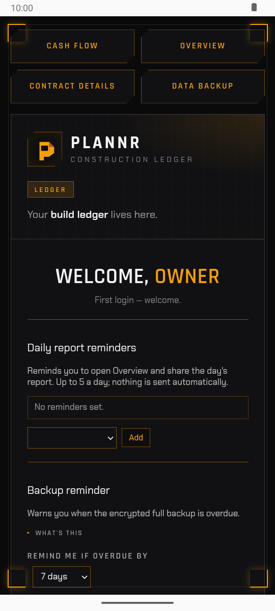
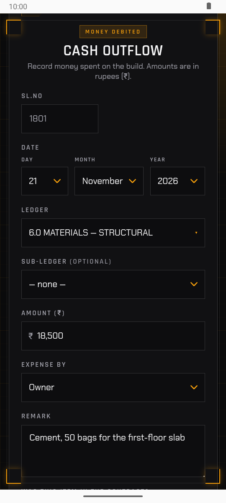
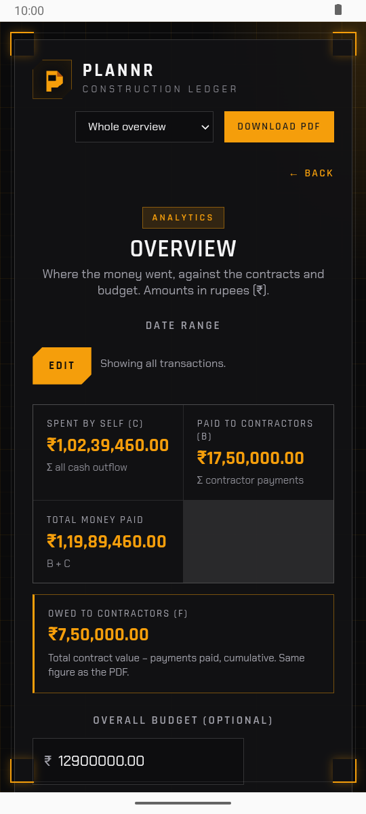
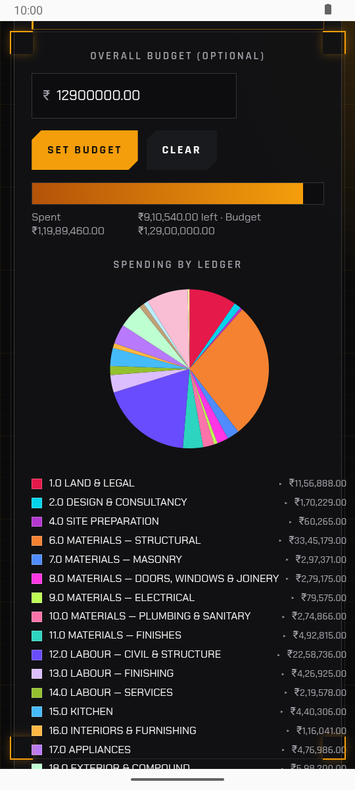
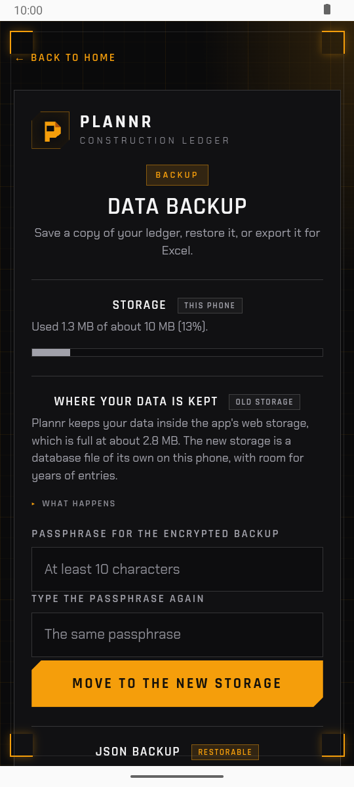
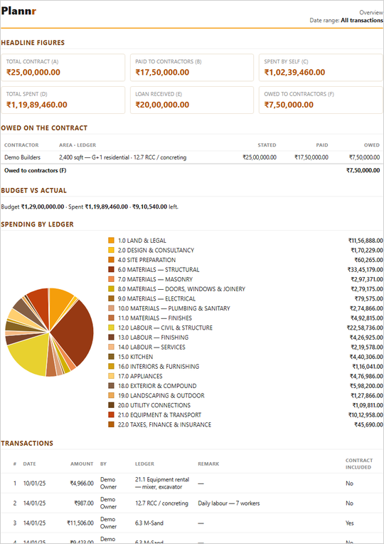

  

<h1 align="center">Plannr</h1>

  Keep track of the money you spend building your home, on your Android phone, fully offline.

  

  
  
  

  
  
  

All screenshots use made-up demo data.

## What it does

- Write down the money you pay out and the money you receive.
- See how much you still owe your builder under the contract.
- Sort your spending into groups, like materials and labour.
- Set a budget and see how much of it is left.
- See where the money went in a chart, and share it as a PDF.
- Fix mistakes: deleted items go to a recycle bin first.

## Your data stays on your phone

Plannr works fully offline and your data stays on your device. Optional features use the internet only when you use them. Android's own Auto Backup may save a copy to your Google account.

There is no account and no sign-in.

## Backups

You can save a backup file at any time, and lock it with a passphrase you choose. To move to a new phone, open that file in Plannr there.

## Install

**Download coming soon.**

When it is out, the [1.0.0 release notes](docs/release-notes-1.0.0.md) say how to install it,
what the Play Protect warning means, and why to make a backup first.

To build it yourself:

1. Install [Node.js](https://nodejs.org/) 24 and [Android Studio](https://developer.android.com/studio).
2. Get the code: `git clone https://github.com/JoelJims/Plannr.git`
3. In the `Plannr` folder, run `npm install`, then `npm run android:sync`.
4. Open the `android` folder in Android Studio, connect your phone, and press **Run**.

If Plannr is already on your phone with your data, don't press **Run**: make a backup first
(Data Backup) and follow [docs/RELEASE.md](docs/RELEASE.md). Never accept an offer to uninstall
Plannr: that deletes your data.

## Built with

[Capacitor](https://capacitorjs.com/), SQLite and plain JavaScript.

## License

MIT. See [LICENSE](LICENSE).

## For developers

How it works, how to run the tests, and how to release an update: [docs/DEVELOPERS.md](docs/DEVELOPERS.md).
